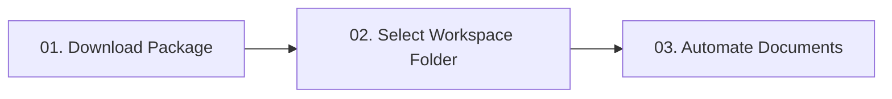
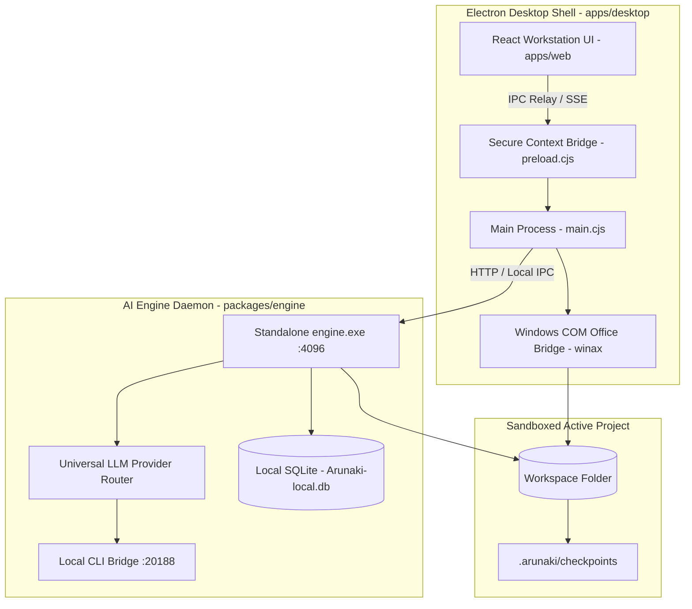

<div align="center">

  

  # arunaki

  **The Desktop Document Agent Workstation & Automation Harness**
  
  *Native desktop computer-use for Microsoft Excel spreadsheets, Word contracts, PowerPoint decks, PDF pipelines, and financial ledgers — operating 100% locally and sandboxed to your active project folder.*

  <br />

  [](https://github.com/jlsrngo/Arunaki)
  [](https://github.com/jlsrngo/Arunaki)
  [](https://github.com/jlsrngo/Arunaki)
  [](docs/BOUNDARIES.md)

  <br />

  [🌐 Official Website](https://juliosiringoringo.space/en/arunaki) •
  [🚀 Quick Start](#-getting-started-3-simple-steps) •
  [📊 Document Features](#-core-document-features) •
  [🏛️ Architecture](#-system-architecture) •
  [🛠️ 50+ Tool Catalog](#-50-agent-tool-catalog) •
  [🔒 Security Boundaries](#-security--sandbox-boundaries) •
  [💻 Developer Guide](#-developer-guide)

</div>

<br />

---

## 🖥️ Live Workstation Console Preview

```bash
┌────────────────────────────────────────────────────────────────────────────────────────┐
│ ● ● ●  arunaki-agent // headless-com-worker                bun: 1.3.14 • electron: 43.2 │
├────────────────────────────────────────────────────────────────────────────────────────┤
│ > Workspace Root: C:\Users\Finance\Documents\Workspace                                  │
│ > "Summarize today's expenses into financial_report.xlsx on sheet                       │
│    'August 2026', calculate total net margin automatically."                           │
│                                                                                        │
│ [Security]      Checked path inside sandbox: ./workspace/report.xlsx (ACCESS GRANTED)  │
│ [Snapshot]      Created immutable checkpoint: .arunaki/checkpoints/20260924_1340_report │
│ [COM Bridge]    Attaching to native Microsoft Excel COM (headless)... Attached PID 9482 │
│ [Execution]     Injected 34 rows into sheet "August 2026" (Range A24:E57)              │
│ [Formula Guard] Preserved dynamic formulas: =SUM(D24:D57) and =IF(E58>0,"PROFIT",...) │
│ [Success]       Worksheet saved & closed. 0 schema conflicts. 1-Click Rollback ready.  │
└────────────────────────────────────────────────────────────────────────────────────────┘
```

---

## ⚡ Core Philosophy: *Minimal Typing, Maximum Automation*

Arunaki is engineered with a strict user-first principle: **users type minimally; the agent automates comprehensively**:
- **Paste Raw Notes Directly:** Simply copy and paste unformatted WhatsApp messages or raw transaction notes straight into the chat composer (`"update this to daily report:" + [paste unformatted text]`).
- **3-Word Prompts:** Type concise instructions such as *"Summarize to Excel"* — Arunaki autonomously determines which workbook to open, which columns to populate, and which summary totals require recalculation.
- **Zero Formula Hassle:** Never force users to craft custom mathematical formulas or rigid layout rules — Arunaki's LLM engine parses and executes them autonomously.

---

## 🚀 Getting Started (3 Simple Steps)



### 1. Download Installer
| Platform | Distribution Format | Packaging Status | System Requirements |
| :--- | :--- | :--- | :--- |
| **Windows** | `Arunaki-Setup.exe`<br>`Arunaki-Portable.exe` | ✅ Standalone Ready | Windows 10 / 11 (64-bit)<br>MS Office 2016+ *(optional, for native COM)* |
| **macOS** | `Arunaki-Universal.dmg` | 🔄 In Development | macOS 12.0 (Monterey) or higher |

### 2. Choose Your Workspace Folder
Launch Arunaki and select your local working directory (e.g. `D:\Company_Financials_2026`).
> **Strict Folder Isolation:** Arunaki operates on an **agent-per-folder** model (identical to VS Code's `cwd`). The agent is strictly sandboxed to read and modify files only within your active folder. Operating system files, user home directories, and external paths are permanently blocked.

### 3. Automate with Natural Language
Type your instructions naturally:
- *"Extract all receipt files in this folder into operational_recap.xlsx"*
- *"Update the client name in service_agreement.docx to PT Surya Mandiri"*
- *"Merge all monthly invoices into a single PDF and apply a PAID stamp"*

---

## 📊 Core Document Features

### 1. 📈 Microsoft Excel Automation (`.xlsx`, `.xlsm`, `.csv`)
- **Native Windows COM Bridge (WinAX):** Controls Microsoft Excel headless in the background with 100% native formatting fidelity.
- **Formula Guard:** Preserves and evaluates dynamic formulas (`=SUM()`, `=VLOOKUP()`, `=IF()`, `=INDEX(MATCH())`) without ever flattening them into static numbers.
- **Multi-Sheet Management:** Clones monthly template sheets, formats cell ranges, applies branded border colors, and generates automatic subtotal blocks.
- **Embedded Fast Viewer:** Native grid spreadsheet viewer embedded directly in the workstation UI without requiring external software.

### 2. 📝 Word Contracts & Legal Authoring (`.docx`)
- **Template Placeholder Matching:** Automatically detects and populates dynamic variables (e.g. `{{CLIENT_NAME}}`, `{{EFFECTIVE_DATE}}`, `{{CONTRACT_VALUE}}`).
- **Structured Content Generation:** Authors formal legal clauses, formatted numbered lists, and styled multi-column tables.
- **Direct PDF Export:** Compiles completed Word contracts directly to PDF ready for execution.

### 3. 📑 PowerPoint Presentation Decks (`.pptx`)
- **Automated Slide Generation:** Constructs new slides complete with titles, structured bullet cards, and layout containers.
- **Text Frame Updates:** Updates executive metric callouts and summary tables across existing slide decks.

### 4. 🛡️ PDF Pipelines, Digital Stamps, & PII Redaction
- **Page Manipulation (`pdf_manage_pages`):** Merges dozens of invoice documents or splits specific page ranges cleanly.
- **Stamping & Signatures (`pdf_stamp_image`):** Applies digital stamps, transparent signatures, and e-Materai seals on precise millimeter coordinates.
- **PII Privacy Redaction (`doc_redact_pii`):** Automatically detects and masks sensitive personal identifiers for regulatory compliance:
  - NIK KTP (Indonesian National Identity Numbers)
  - NPWP (Tax Identification Numbers)
  - Bank Account & Credit Card Numbers
  - Mobile Phone Numbers & Personal Emails

### 5. ⚖️ Document Audit & Redline Comparison (`doc_compare_versions`)
- Compares two contract drafts with visual redline diffing.
- Generates a structured comparison table highlighting added, modified, and removed clauses alongside similarity percentages.

### 6. 🔄 1-Click Checkpoints & Instant Rollback
- Automatically captures an immutable snapshot in `.arunaki/checkpoints/` before applying any file modifications.
- Undo changes instantly with a single click if the result does not match user expectations.

---

## 🏛️ System Architecture

Arunaki is built on a **Hybrid Client-Server Desktop Architecture**:



1. **Desktop Shell (`apps/desktop`):**
   - Built on Electron 43 with a borderless dark-mode titlebar overlay.
   - Secure IPC relay: Renderer process never directly contacts localhost ports or handles credentials.
   - Autonomous Engine Lifecycle: Electron automatically launches `engine.exe` on startup and cleanly terminates it on exit.
2. **Workstation UI (`apps/web`):**
   - Built with React 18, Vite, and Tailwind CSS.
   - Features Monaco Editor, native spreadsheet viewer, developer telemetry metrics, and multi-tab document management.
3. **Backend AI Engine (`packages/engine`):**
   - Ultra-fast Effect-TS server powered by Bun.
   - Comprehensive model routing (OpenAI, Anthropic Claude, Google Gemini, Antigravity, OpenCode, Kiro, Codex, Groq, and OpenRouter).
4. **Local CLI Bridge (`port 20188`):**
   - Local daemon enabling token-pooling from existing installed CLI subscriptions without cloud API fees.

---

## 🛠️ 50+ Agent Tool Catalog

| Category | Primary Tools | Operational Scope |
| :--- | :--- | :--- |
| **Workspace Files** | `read_file`, `write_file`, `edit_file`, `list_directory`, `search_files`, `rename_file`, `delete_file` | Safe CRUD operations, surgical diff line patching, regex search, atomic file lifecycle. |
| **Office Automation** | `desktop_excel_edit`, `desktop_word_edit`, `desktop_ppt_edit`, `desktop_open_file` | Native COM automation, formula retention, cell manipulation, template styling, PDF export. |
| **PDF & Compliance** | `pdf_manage_pages`, `pdf_stamp_image`, `doc_redact_pii`, `convert_document` | Document merging, page extraction, watermark/signature stamping, PII masking. |
| **Document Audit** | `doc_compare_versions`, `extract_structured_data`, `document_reader` | Redline differential tables, financial table extraction, clause similarity analysis. |
| **Data & Calculations** | `data_query`, `unit_converter`, `draft_communication`, `generate_export` | Local SQLite database queries, unit/currency conversions, message drafting, CSV/XLSX export. |
| **Orchestration** | `todo_write`, `batch_execute`, `agent_spawn`, `ask_user` | Working memory task tracking, Programmatic Tool Calling (PTC), sub-agent delegation. |

---

## 🔒 Security & Sandbox Boundaries

- 🛡️ **Zero Operating System Access:** The agent cannot access `C:\Windows`, system registries, user documents outside the active folder, or source code of other applications.
- 🚫 **Zero Arbitrary Shell Execution:** The agent is strictly prohibited from running arbitrary terminal commands (`cmd.exe`, `powershell`, `bash`, `rmdir /s`).
- 📂 **Original File Protection:** Original documents are backed up to local checkpoints prior to any write or edit operation.
- 👁️ **Full Execution Transparency:** Every action taken by the agent is displayed in real-time within collapsible execution telemetry cards.

---

## 💻 Developer Guide

### Environment Prerequisites
- [Node.js](https://nodejs.org/) v20+ / npm v10+
- [Bun](https://bun.sh/) v1.2+ (for engine execution and native compilation)
- Git

### Running in Development Mode
```bash
# 1. Clone the repository
git clone https://github.com/jlsrngo/Arunaki.git
cd Arunaki

# 2. Install workspace dependencies
npm install

# 3. Start development environment (Vite UI + Electron Desktop Shell)
npm run dev:app
```

### Standalone Bundle Preparation
```bash
# Run the 1-click preparation pipeline:
# - Builds the React Vite frontend
# - Syncs bundle into apps/desktop/web/
# - Compiles the AI engine into engine.exe (Bun native binary)
# - Verifies artifact integrity
npm run bundle:prepare
```

### Code Quality & Verification
```bash
npm run typecheck    # Verify web TypeScript types (0 errors)
npm run verify       # Full verification gate (build + typecheck + smoke tests)
```

---

## 📄 License & Credits

Open source and crafted with precision by [Julio Siringoringo](https://juliosiringoringo.space).  
Distributed under the **MIT License**. Built for local, private, and automated document workflows.
