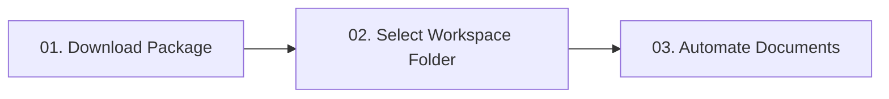
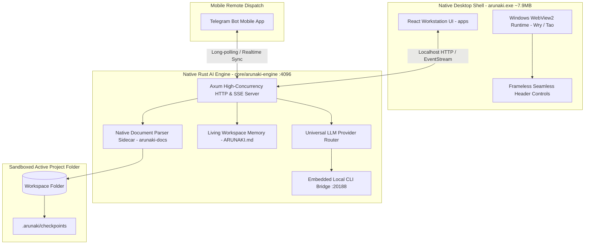

<div align="center">

  

  # arunaki

  **The Pure Native Rust Desktop Document Agent Workstation & Automation Harness**
  
  *Native desktop computer-use for Microsoft Excel spreadsheets, Word contracts, PowerPoint decks, PDF pipelines, and financial ledgers — operating 100% locally and sandboxed to your active project folder.*

  <br />

  [](https://github.com/jlsrngo/Arunaki)
  [](https://github.com/jlsrngo/Arunaki)
  [](https://github.com/jlsrngo/Arunaki)
  [](https://github.com/jlsrngo/Arunaki)
  [](LICENSE)
  [](docs/BOUNDARIES.md)

  <br />

  [🌐 Official Website](https://juliosiringoringo.space/en/arunaki) •
  [🚀 Quick Start](#-getting-started-3-simple-steps) •
  [📊 Document Features](#-core-document-features) •
  [🏛️ Architecture](#-system-architecture) •
  [🛠️ Native Tool Catalog](#-native-agent--desktop-tool-catalog) •
  [🔒 Security Boundaries](#-security--sandbox-boundaries) •
  [💻 Developer Guide](#-developer-guide)

</div>

<br />

---

## 🖥️ Live Workstation Console Preview

```bash
┌────────────────────────────────────────────────────────────────────────────────────────┐
│ ● ● ●  arunaki // native-rust-engine                       rust: 1.80+ • webview2: edge│
├────────────────────────────────────────────────────────────────────────────────────────┤
│ > Workspace Root: D:\Company_Financials_2026                                           │
│ > "Summarize today's expenses into financial_report.xlsx on sheet                       │
│    'August 2026', calculate total net margin automatically."                           │
│                                                                                        │
│ [Security]      Checked path inside sandbox: ./workspace/report.xlsx (ACCESS GRANTED)  │
│ [Snapshot]      Created immutable checkpoint: .arunaki/checkpoints/20261023_1630_report │
│ [COM Bridge]    Attaching to native Microsoft Excel COM (headless)... Attached PID 9482 │
│ [Execution]     Injected 34 rows into sheet "August 2026" (Range A24:E57)              │
│ [Formula Guard] Preserved dynamic formulas: =SUM(D24:D57) and =IF(E58>0,"PROFIT",...) │
│ [Success]       Worksheet saved & closed. 0 schema conflicts. 1-Click Rollback ready.  │
└────────────────────────────────────────────────────────────────────────────────────────┘
```

---

## ⚡ Core Philosophy: *Minimal Typing, Maximum Automation*

Arunaki is engineered with a strict user-first principle: **users type minimally; the agent automates comprehensively**:
- **Paste Raw Notes Directly:** Simply copy and paste unformatted WhatsApp messages or raw transaction notes straight into the chat composer (`"update this to daily report:" + [paste unformatted text]`).
- **3-Word Prompts:** Type concise instructions such as *"Summarize to Excel"* — Arunaki autonomously determines which workbook to open, which columns to populate, and which summary totals require recalculation.
- **Zero Formula Hassle:** Never force users to craft custom mathematical formulas or rigid layout rules — Arunaki's LLM engine parses and executes them autonomously.

---

## 🚀 Getting Started (3 Simple Steps)



### 1. Download Installer
| Platform | Distribution Format | Packaging Status | System Requirements |
| :--- | :--- | :--- | :--- |
| **Windows** | `arunaki.exe` *(~7.9 MB Standalone)* | ✅ Pure Native Ready | Windows 10 / 11 (64-bit)<br>MS Office 2016+ *(optional, for native COM)* |
| **Linux** | `arunaki-linux-x86_64` | ✅ Supported | Ubuntu 22.04+ / Debian (WebKitGTK) |
| **macOS** | `Arunaki.app` | 🔄 In Development | macOS 12.0 (Monterey) or higher |

### 2. Choose Your Workspace Folder
Launch Arunaki and select your local working directory (e.g. `D:\Company_Financials_2026`).
> **Strict Folder Isolation:** Arunaki operates on an **agent-per-folder** model (identical to VS Code's `cwd`). The agent is strictly sandboxed to read and modify files only within your active folder. Operating system files, user home directories, and external paths are permanently blocked.

### 3. Automate with Natural Language
Type your instructions naturally:
- *"Extract all receipt files in this folder into operational_recap.xlsx"*
- *"Update the client name in service_agreement.docx to PT Surya Mandiri"*
- *"Merge all monthly invoices into a single PDF and apply a PAID stamp"*

---

## 📊 Core Document Features

### 1. 📈 Microsoft Excel Automation (`.xlsx`, `.xlsm`, `.csv`)
- **Native Windows COM Bridge:** Controls Microsoft Excel headless in the background with 100% native formatting fidelity.
- **Formula Guard:** Preserves and evaluates dynamic formulas (`=SUM()`, `=VLOOKUP()`, `=IF()`, `=INDEX(MATCH())`) without ever flattening them into static numbers.
- **Multi-Sheet Management:** Clones monthly template sheets, formats cell ranges, applies branded border colors, and generates automatic subtotal blocks.
- **Embedded Fast Viewer:** Native grid spreadsheet viewer embedded directly in the workstation UI without requiring external software.

### 2. 📝 Word Contracts & Legal Authoring (`.docx`)
- **Template Placeholder Matching:** Automatically detects and populates dynamic variables (e.g. `{{CLIENT_NAME}}`, `{{EFFECTIVE_DATE}}`, `{{CONTRACT_VALUE}}`).
- **Structured Content Generation:** Authors formal legal clauses, formatted numbered lists, and styled multi-column tables.
- **Direct PDF Export:** Compiles completed Word contracts directly to PDF ready for execution.

### 3. 📑 PowerPoint Presentation Decks (`.pptx`)
- **Automated Slide Generation:** Constructs new slides complete with titles, structured bullet cards, and layout containers.
- **Text Frame Updates:** Updates executive metric callouts and summary tables across existing slide decks.

### 4. 🛡️ PDF Pipelines, Digital Stamps, & Text Extraction
- **Page Manipulation & Text Layer:** Extracts selectable text and structural layout across multi-page PDF documents.
- **Invoice & Statement Analysis:** Automatically ingests PDF invoices and summarizes transactions directly into spreadsheet ledgers.

### 5. 🔄 1-Click Checkpoints & Instant Rollback
- Automatically captures an immutable snapshot in `.arunaki/checkpoints/` before applying any file modifications.
- Undo changes instantly with a single click if the result does not match user expectations.

### 6. 📱 Remote Control via Telegram Bot (Mobile Document Gateway)
- **Zero-Friction Mobile Dispatch:** Forward unformatted receipts, voice notes, or WhatsApp text directly to your paired Arunaki Telegram Bot from anywhere.
- **Bi-directional Live Streaming:** The desktop workstation processes document tasks locally and streams progress notifications, step checklists, and confirmation badges back to your Telegram chat.
- **Secure Pair-Code Authentication:** Zero unauthorized access — only Telegram User IDs explicitly paired via the workstation settings panel can dispatch commands.

---

## 🏛️ System Architecture

Arunaki is built on a **High-Performance Pure Native Rust + Web Client Architecture** (0 Electron):



1. **Native Desktop Shell (`arunaki.exe`):**
   - Built on Rust (`tao` + `wry` Edge WebView2) with a modern frameless dark-mode header overlay.
   - Memory consumption: **~60 MB – 80 MB** (down from ~500 MB in Electron — **>80% lighter**).
   - Single standalone binary (~7.9 MB) with zero Node.js runtime overhead.
2. **Workstation UI (`apps`):**
   - Built with React 19, Vite, and Tailwind CSS.
   - Features Monaco Editor, native spreadsheet viewer, developer telemetry metrics, and multi-tab document management.
3. **Backend AI Engine (`core/arunaki-engine`):**
   - Pure native Rust server on `:4096`.
   - Comprehensive model routing (AWS Kiro Claude, OpenCode Zen, Google Antigravity Gemini, OpenAI Codex, Claude).
   - Embedded Telegram Gateway Worker for remote command dispatch.
4. **Local CLI Bridge (`port 20188`):**
   - Embedded local daemon enabling token-pooling from existing installed CLI subscriptions without cloud API fees.

---

## 🛠️ Native Agent & Desktop Tool Catalog

Arunaki's capabilities are divided into **15 Core LLM Agent Tools** (callable by the AI during conversation) and **17 Desktop System IPC Operations** (used by the workstation shell):

### 1. 🤖 15 Core LLM Document & Workspace Tools
*All tools feature comprehensive instruction prompts embedded via `core/arunaki-engine/src/tool/prompt/*.txt`.*

| Tool Name | Dedicated Prompt | Purpose & Operational Scope |
| :--- | :--- | :--- |
| `excel_read` | [`excel_read.txt`](core/arunaki-engine/src/tool/prompt/excel_read.txt) | Extract sheet names, table coordinates, data cells, and calculation formulas from Excel workbooks. |
| `excel_com` | [`excel_com.txt`](core/arunaki-engine/src/tool/prompt/excel_com.txt) | Native Windows Excel COM automation: cell updates, formula integrity preservation (SUM/TOTAL), row expansion, styling. |
| `word_read` | [`word_read.txt`](core/arunaki-engine/src/tool/prompt/word_read.txt) | Parse structured paragraph hierarchies, heading levels (H1-H3), bullet runs, and embedded tables from Word documents. |
| `word_com` | [`word_com.txt`](core/arunaki-engine/src/tool/prompt/word_com.txt) | Native Windows Word COM automation: style formatting, text append, placeholder replacement without breaking typography. |
| `ppt_read` | [`ppt_read.txt`](core/arunaki-engine/src/tool/prompt/ppt_read.txt) | Inspect presentation slides, shapes, title frames, bullet layouts, and speaker notes. |
| `ppt_com` | [`ppt_com.txt`](core/arunaki-engine/src/tool/prompt/ppt_com.txt) | Native Windows PowerPoint COM automation: slide creation, shape text updates, layout containers. |
| `pdf_read` | [`pdf_read.txt`](core/arunaki-engine/src/tool/prompt/pdf_read.txt) | Extract selectable plain text and multi-page structured content from PDF documents. |
| `read` / `read_file` | [`read.txt`](core/arunaki-engine/src/tool/prompt/read.txt) | Read filesystem content with line numbers and offset pagination inside active workspace. |
| `write` / `write_file` | [`write.txt`](core/arunaki-engine/src/tool/prompt/write.txt) | Create new files strictly sandboxed to the active workspace folder. |
| `edit` / `edit_file` | [`edit.txt`](core/arunaki-engine/src/tool/prompt/edit.txt) | Precise search-and-replace string patching with surrounding context matching. |
| `glob` / `list_files` | [`glob.txt`](core/arunaki-engine/src/tool/prompt/glob.txt) | Discover filenames and paths across workspace using wildcard/glob patterns. |
| `grep` / `search_files`| [`grep.txt`](core/arunaki-engine/src/tool/prompt/grep.txt) | Regex search within files to locate relevant references and data. |
| `todowrite` / `todo` | [`todowrite.txt`](core/arunaki-engine/src/tool/prompt/todowrite.txt) | Working memory task tracking for multi-step agent plans. |
| `websearch` | [`websearch.txt`](core/arunaki-engine/src/tool/prompt/websearch.txt) | Real-time web search for market data, regulatory standards, or exchange rates. |
| `question` | [`question.txt`](core/arunaki-engine/src/tool/prompt/question.txt) | Request interactive user clarification before making ambiguous document edits. |

### 2. 🖥️ 17 Desktop Shell & System Operations (`/api/desktop/*`)
| Operation | HTTP Route | Description |
| :--- | :--- | :--- |
| `pick-folder` | `POST /api/desktop/pick-folder` | Spawns native Windows OS folder picker dialog to select active workspace. |
| `folder-tree` | `POST /api/desktop/folder-tree` | Returns recursive JSON hierarchy of active workspace directory. |
| `read-file` | `POST /api/desktop/read-file` | Reads file content with sandboxed folder isolation verification. |
| `write-file` | `POST /api/desktop/write-file` | Writes document file atomically with sandbox verification. |
| `create-folder` | `POST /api/desktop/create-folder` | Creates subfolders inside active workspace. |
| `backup-folder` | `POST /api/desktop/backup-folder` | Generates immutable checkpoint snapshot before edits. |
| `delete-path` | `POST /api/desktop/delete-path` | Moves unwanted files to backup or deletes cleanly. |
| `rename-path` | `POST /api/desktop/rename-path` | Renames paths safely within active workspace. |
| `open-path` | `POST /api/desktop/open-path` | Opens file in default operating system viewer. |
| `open-excel` | `POST /api/desktop/open-excel` | Launches Microsoft Excel native application with target workbook. |
| `open-word` | `POST /api/desktop/open-word` | Launches Microsoft Word native application with target document. |
| `parse-excel` | `POST /api/desktop/parse-excel` | High-speed binary parser extracting sheets and tabular grids. |
| `write-excel` | `POST /api/desktop/write-excel` | High-speed binary workbook generator. |
| `read-binary` | `POST /api/desktop/read-binary` | Reads binary assets (images, PDF) for UI rendering. |
| `read-clipboard-image` | `POST /api/desktop/read-clipboard-image` | Extracts images directly from Windows clipboard for chat input. |
| `engine-info` | `GET /api/desktop/engine-info` | Returns backend engine health, version, and bridge status. |
| `quit` | `POST /api/desktop/quit` | Gracefully closes all background threads and terminates application. |

---

## 🔒 Security & Sandbox Boundaries

- 🛡️ **Zero Operating System Access:** The agent cannot access `C:\Windows`, system registries, user documents outside the active folder, or source code of other applications.
- 🚫 **Zero Arbitrary Shell Execution:** The agent is strictly prohibited from running arbitrary terminal commands (`cmd.exe`, `powershell`, `bash`, `rmdir /s`).
- 📂 **Original File Protection:** Original documents are backed up to local checkpoints prior to any write or edit operation.
- 👁️ **Full Execution Transparency:** Every action taken by the agent is displayed in real-time within collapsible execution telemetry cards and visible console output.

---

## 💻 Developer Guide

### Environment Prerequisites
- [Rust](https://rustup.rs/) 1.80+ (with `cargo`)
- [Node.js](https://nodejs.org/) v20+ / npm v10+ or [Bun](https://bun.sh/)
- Git

### Running in Development Mode
```bash
# 1. Clone the repository
git clone https://github.com/jlsrngo/Arunaki.git
cd Arunaki

# 2. Build Web Frontend
npm run build -w apps

# 3. Start Native Desktop Application (Pure Rust + WebView2)
npm start
```
*Or simply run `target/release/arunaki.exe` directly from Windows Explorer!*

### Full Verification Gate
```bash
npm run verify       # Full verification: build web + cargo test + live smoke tests (8/8)
```

---

## 📄 License & Credits

Open source and crafted with precision by [Julio Siringoringo](https://juliosiringoringo.space).  
Distributed under the **Apache License, Version 2.0**. See the [LICENSE](LICENSE) file for the full license text, trademark policies, and patent grants.
