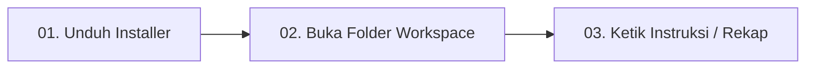
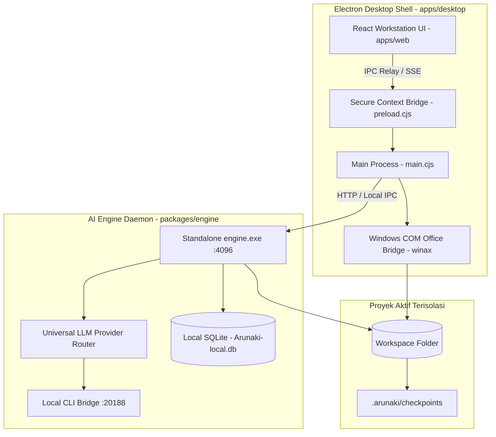

<div align="center">

  

  # arunaki

  **Workstation Agen Dokumen Desktop & Otomasi Sandboxed**
  
  *Native desktop computer-use untuk spreadsheet Microsoft Excel, kontrak Word, slide presentasi PowerPoint, pipeline PDF, dan pembukuan finansial — beroperasi 100% lokal dan sandboxed di folder proyek Anda.*

  <br />

  [](https://github.com/jlsrngo/Arunaki)
  [](https://github.com/jlsrngo/Arunaki)
  [](https://github.com/jlsrngo/Arunaki)
  [](docs/BOUNDARIES.md)

  <br />

  [🌐 Website Resmi](https://juliosiringoringo.space/id/arunaki) •
  [🚀 Panduan Mulai](#-panduan-memulai-3-langkah-cepat) •
  [📊 Fitur Dokumen](#-fitur-utama--otomasi-dokumen) •
  [🏛️ Arsitektur](#-arsitektur-sistem) •
  [🛠️ 50+ Katalog Tool](#-katalog-50-tool-agen) •
  [🔒 Batasan Keamanan](#-keamanan--isolasi-sandbox)

</div>

<br />

---

## 🖥️ Pratinjau Konsol Langsung

```bash
┌────────────────────────────────────────────────────────────────────────────────────────┐
│ ● ● ●  arunaki-agent // headless-com-worker                bun: 1.3.14 • electron: 43.2 │
├────────────────────────────────────────────────────────────────────────────────────────┤
│ > Workspace Root: C:\Users\Finance\Documents\Workspace                                  │
│ > "Rekap pemasukan dan pengeluaran hari ini ke laporan_keuangan.xlsx pada               │
│    sheet 'Agustus 2026', hitung total margin otomatis."                                │
│                                                                                        │
│ [Security]      Memeriksa jalur dalam sandbox: ./workspace/laporan.xlsx (IZIN DIBERIKAN)│
│ [Snapshot]      Membuat checkpoint lokal: .arunaki/checkpoints/20260924_1340_laporan    │
│ [COM Bridge]    Menghubungkan ke Microsoft Excel COM (headless)... Terhubung PID 9482  │
│ [Execution]     Menyisipkan 34 baris data ke sheet "Agustus 2026" (Rentang A24:E57)    │
│ [Formula Guard] Menjaga rumus dinamis: =SUM(D24:D57) dan =IF(E58>0,"PROFIT","DEFICIT") │
│ [Success]       Worksheet berhasil disimpan. 0 konflik terdeteksi. 1-Klik Rollback siap.│
└────────────────────────────────────────────────────────────────────────────────────────┘
```

---

## ⚡ Nilai Inti: *Minimal Typing, Maximum Automation*

Arunaki dirancang dengan filosofi **pengguna mengetik seminimal mungkin, agen mengeksekusi dengan automasi maksimal**:
- **Copy-Paste Teks Mentah:** Cukup tempelkan pesan WhatsApp atau catatan keuangan berantakan langsung ke composer chat (`"update ini ke laporan harian:" + [paste teks mentah]`).
- **Instruksi 3 Kata:** Cukup ketik instruksi singkat seperti *"Rekap ke Excel"*, dan Arunaki secara cerdas memahami file mana yang harus dibuka, kolom mana yang harus diisi, dan total formula mana yang wajib dihitung ulang.
- **Tanpa Rumus Manual:** Jangan pernah membebani pengguna dengan sintaks formula matematika buatan — biarkan LLM Arunaki menanganinya secara otonom dan presisi.

---

## 🚀 Panduan Memulai (3 Langkah Cepat)



### 1. Unduh Paket Aplikasi
| Platform | Format Distribusi | Status Kesiapan | Persyaratan Sistem |
| :--- | :--- | :--- | :--- |
| **Windows** | `Arunaki-Setup.exe`<br>`Arunaki-Portable.exe` | ✅ Standalone Ready | Windows 10 / 11 (64-bit)<br>MS Office 2016+ *(opsional, untuk native COM)* |
| **macOS** | `Arunaki-Universal.dmg` | 🔄 Dalam Pengerjaan | macOS 12.0 (Monterey) ke atas |

### 2. Tentukan Folder Proyek Aktif
Buka Arunaki dan pilih folder kerja lokal Anda (misal: `D:\Laporan_Keuangan_2026`). 
> **Prinsip Isolasi Kritis:** Arunaki mengadopsi model **agent-per-folder** (seperti `cwd` di VSCode). Agen hanya dapat membaca dan memodifikasi file di dalam folder aktif yang dipilih. Seluruh file sistem, OS, dan folder di luar workspace diblokir secara permanen.

### 3. Eksekusi Perintah Dokumen
Ketik kebutuhan Anda dalam bahasa Indonesia alami:
- *"Rekap seluruh nota pengeluaran di folder ini ke tabel rekap_operasional.xlsx"*
- *"Ganti nama pihak kedua di kontrak_sewa.docx menjadi PT Surya Mandiri"*
- *"Gabungkan seluruh file invoice PDF bulan ini dan pasang stempel LUNAS"*

---

## 📊 Fitur Utama & Otomasi Dokumen

### 1. 📈 Microsoft Excel Spreadsheet Automation (`.xlsx`, `.xlsm`, `.csv`)
- **Native Windows COM Automation (WinAX):** Mengendalikan aplikasi Microsoft Excel asli secara *headless* di background untuk performa dan akurasi 100%.
- **Formula Guard:** Mempertahankan dan mengevaluasi rumus dinamis (`=SUM()`, `=VLOOKUP()`, `=IF()`, `=INDEX(MATCH())`) tanpa pernah menimpanya menjadi teks statis angka mati.
- **Multi-Sheet Management:** Kloning template sheet bulanan, penataan rentang cell, pewarnaan border selaras tema, dan kalkulasi subtotal otomatis.
- **Embedded Fast Viewer:** Pratinjau grid lembar kerja langsung di antarmuka desktop workstation tanpa harus membuka aplikasi luar.

### 2. 📝 Dokumen Kontrak & Administrasi Word (`.docx`)
- **Template Placeholder Matching:** Mengisi variabel dinamis dokumen secara instan (contoh: `{{NAMA_KLIEN}}`, `{{TANGGAL}}`, `{{NOMOR_KONTRAK}}`, `{{NILAI_PROYEK}}`).
- **Structured Content Generation:** Menyusun paragraf resmi, butir perjanjian terformat, dan tabel bergaris rapi sesuai format baku korporasi.
- **Export Langsung ke PDF:** Mengonversi dokumen kontrak `.docx` menjadi PDF siap tanda tangan dalam satu langkah.

### 3. 📑 Presentasi PowerPoint (`.pptx`)
- **Slide Authoring:** Membuat slide baru dengan struktur judul, subjudul, dan kartu poin otomatis.
- **Text Frame Updating:** Memperbarui metrik laporan bulanan dan grafik ringkasan pada deck presentasi eksekutif.

### 4. 🛡️ Pipeline PDF, e-Materai, & Redaksi Privasi (PII)
- **Manipulasi Halaman (`pdf_manage_pages`):** Menggabungkan (*merge*) puluhan invoice menjadi satu berkas atau memecah (*split*) halaman tertentu.
- **Stempel & Digital Signature (`pdf_stamp_image`):** Membubuhkan stempel digital, tanda tangan basah transparan, dan e-Materai pada koordinat milimeter yang presisi.
- **Redaksi Data Pribadi (`doc_redact_pii`):** Mendeteksi dan menyensor otomatis data identitas sensitif Indonesia untuk kepatuhan hukum:
  - NIK KTP (Nomor Induk Kependudukan)
  - NPWP (Nomor Pokok Wajib Pajak)
  - Nomor Rekening Bank & Kartu Kredit
  - Nomor Telepon Seluler & Alamat Email Pribadi

### 5. ⚖️ Audit Dokumen & Perbandingan Redline (`doc_compare_versions`)
- Membandingkan dua draf kontrak yang berbeda secara visual.
- Menghasilkan tabel redline komparatif: klausul yang ditambahkan, dihapus, atau diubah beserta persentase kemiripan dokumen.

### 6. 🔄 1-Klik Checkpoint & Instant Rollback
- Setiap kali agen hendak mengubah isi file, Arunaki secara otomatis mengambil snapshot lokal di `.arunaki/checkpoints/`.
- Jika hasil rekap tidak sesuai kehendak pengguna, cukup klik tombol **Rollback** untuk mengembalikan dokumen ke keadaan semula tanpa kehilangan data asli.

---

## 🏛️ Arsitektur Sistem

Arunaki dibangun dengan arsitektur **Hybrid Client-Server Desktop**:



1. **Desktop Shell (`apps/desktop`):**
   - Jendela aplikasi berbasis Electron 43 dengan custom titlebar monokrom gelap.
   - IPC relay aman: Chromium sandbox tidak pernah mengekspos port HTTP atau kredensial langsung ke renderer.
   - Auto-Spawn: Electron otomatis menyalakan binary `engine.exe` saat app dibuka dan mematikannya saat app ditutup.
2. **Frontend Workstation (`apps/web`):**
   - Dibangun dengan React 18, Vite, dan Tailwind CSS.
   - Dilengkapi Monaco Editor, Spreadsheet viewer native, visual telemetry developer, dan tab sistem multi-dokumen.
3. **Backend AI Engine (`packages/engine`):**
   - Server Effect-TS super-cepat berbasis Bun.
   - Terintegrasi dengan berbagai penyedia LLM (OpenAI, Anthropic Claude, Google Gemini, Antigravity, OpenCode, Kiro, Codex, Groq, dan OpenRouter).
4. **Local CLI Bridge (`port 20188`):**
   - Daemon lokal untuk token-pooling dari langganan CLI yang sudah terpasang di komputer pengguna tanpa perlu menyewa API cloud tambahan.

---

## 🛠️ Katalog 50+ Tool Agen

| Kategori | Tool Utama | Cakupan Kemampuan |
| :--- | :--- | :--- |
| **Workspace File** | `read_file`, `write_file`, `edit_file`, `list_directory`, `search_files`, `rename_file`, `delete_file` | CRUD dokumen aman, patch diff baris spesifik, pencarian regex, manajemen path. |
| **Office Automation** | `desktop_excel_edit`, `desktop_word_edit`, `desktop_ppt_edit`, `desktop_open_file` | Automasi COM native, formula retention, edit cell, pemformatan template, ekspor PDF. |
| **PDF & Kepatuhan** | `pdf_manage_pages`, `pdf_stamp_image`, `doc_redact_pii`, `convert_document` | Penggabungan berkas, ekstraksi halaman, stempel e-Materai, masking NIK/NPWP. |
| **Audit Dokumen** | `doc_compare_versions`, `extract_structured_data`, `document_reader` | Tabel redline komparatif, ekstraksi tabel angka finansial, analisis kemiripan draf. |
| **Data & Kalkulasi** | `data_query`, `unit_converter`, `draft_communication`, `generate_export` | Query database SQLite lokal, konversi mata uang/satuan, draft pesan, ekspor CSV/XLSX. |
| **Orkestrator** | `todo_write`, `batch_execute`, `agent_spawn`, `ask_user` | Checklist working memory, Programmatic Tool Calling (PTC), sub-agent delegator. |

---

## 🔒 Keamanan & Isolasi Sandbox

- 🛡️ **Zero Computer Access:** Agen tidak memiliki akses ke drive `C:\Windows`, registry sistem, dokumen pribadi di luar folder aktif, atau source code aplikasi lain.
- 🚫 **Zero Terminal Execution:** Agen dilarang keras mengeksekusi perintah shell berbahaya (`cmd.exe`, `powershell`, `bash`, `rmdir /s`).
- 📂 **Original File Protection:** Dokumen asli selalu diproteksi dengan *snapshot backup* sebelum dilakukan modifikasi apa pun.
- 👁️ **Transparansi Penuh:** Setiap langkah eksekusi ditampilkan secara visual di panel telemetry antarmuka (*collapsible execution card*).

---

## 💻 Panduan Pengembangan (Developer Guide)

### Prasyarat Lingkungan
- [Node.js](https://nodejs.org/) v20+ / npm v10+
- [Bun](https://bun.sh/) v1.2+ (untuk eksekusi engine dan compiler native)
- Git

### Menjalankan Mode Pengembangan
```bash
# 1. Clone repository
git clone https://github.com/jlsrngo/Arunaki.git
cd Arunaki

# 2. Install seluruh dependensi
npm install

# 3. Jalankan aplikasi workstation (Web UI + Electron Shell)
npm run dev:app
```

### Mempersiapkan Bundel Produksi Standalone
```bash
# Menjalankan pipeline kompilasi 1-klik:
# - Build frontend React Vite
# - Sync bundle ke folder desktop
# - Compile AI engine ke engine.exe (Bun standalone)
# - Verifikasi integritas artefak
npm run bundle:prepare
```

### Pengecekan Kualitas Kode
```bash
npm run typecheck    # Verifikasi TypeScript web (0 error)
npm run verify       # Full verification gate (build + typecheck + smoke test)
```

---

## 📄 Lisensi & Hak Cipta

Hak Cipta © 2026 **Arunaki** — Dikembangkan oleh [Julio Siringoringo](https://juliosiringoringo.space). Seluruh hak cipta dilindungi undang-undang.
