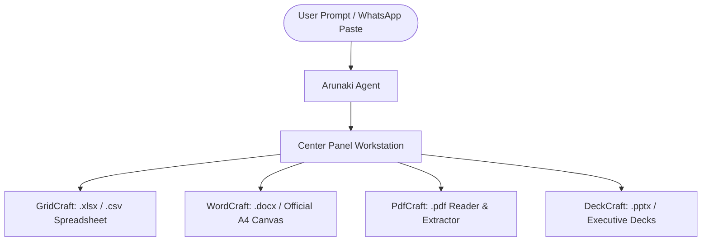
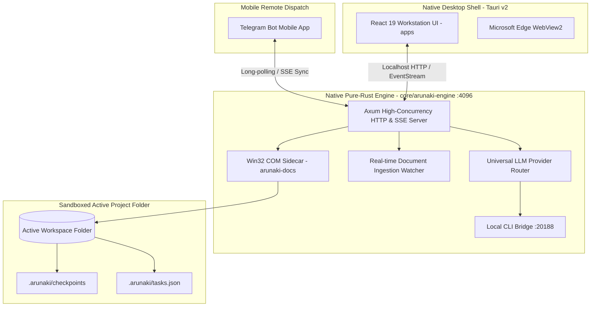

<div align="center">

  

  # arunaki

  **Autonomous Document Operating System & Desktop Computer Use Agent**
  
  *Native desktop workstation for spreadsheets, official contracts, slide decks, PDF pipelines, financial ledgers, and operational SOPs — operating 100% locally, sandboxed to your active project folder.*

  <br />

  [-09090b?style=for-the-badge&logo=windows&logoColor=white)](https://github.com/jlsrngo/Arunaki)
  [](https://github.com/jlsrngo/Arunaki)
  [](https://github.com/jlsrngo/Arunaki)
  [](https://github.com/jlsrngo/Arunaki)
  [](https://github.com/jlsrngo/Arunaki)
  [](LICENSE)
  [](docs/BOUNDARIES.md)

  <br />

  [🌐 Official Website](https://juliosiringoringo.space/en/arunaki) •
  [🚀 Quick Start](#-getting-started-in-3-steps) •
  [🎨 ArtCraft Document Suite](#-artcraft-autonomous-document-suite) •
  [🏛️ Architecture](#-system-architecture) •
  [🛠️ Native Tool Catalog](#-native-agent--desktop-tool-catalog) •
  [🔒 Security Boundaries](#-security--sandbox-boundaries) •
  [📄 License](#-license--credits)

</div>

<br />

---

## ⚡ Core Philosophy: *Minimal Typing, Maximum Automation*

Arunaki is engineered with a strict principle: **users type minimally; the agent automates comprehensively**:
- **Paste Raw Notes Directly:** Simply copy and paste unformatted WhatsApp messages or messy transaction notes straight into the chat composer (`"update this to daily report:" + [paste unformatted text]`).
- **3-Word Instructions:** Type concise commands such as *"Summarize to Excel"* — Arunaki autonomously identifies the relevant files, determines the right columns, evaluates required formulas, and opens the document tab in the Center Panel.
- **Zero Formula Hassle:** Never force users to write complex formulas or layout rules — Arunaki's LLM engine parses and executes them autonomously.
- **Pure Document Focus:** Operates strictly on documents, spreadsheets, slides, and administrative records inside the active folder — no shell scripts, no coding tampering, no external system risks.

---

## 🎨 ArtCraft Autonomous Document Suite

Arunaki is a complete **Autonomous Document Operating System**. Its Center Panel integrates 4 standalone in-app document applications (**ArtCraft**) that open, edit, and sync live with the AI without requiring external software licenses:



### 1. 📊 GridCraft (`.xlsx`, `.csv`)
- **Full Interactive Spreadsheet:** Embedded tabular grid with formula bar, row/column coordinate indicators, cell range selection, and CSV/XLSX export.
- **Dynamic Formula Engine:** Evaluates and preserves live mathematical formulas (`=SUM()`, `=AVERAGE()`, `=IF()`, `=VLOOKUP()`, `=INDEX(MATCH())`) without flattening calculations into static values.
- **Live AI Synchronization:** Watch cells update, rows insert, and totals recalculate in real-time as the agent summarizes transaction ledgers.

### 2. 📝 WordCraft (`.docx`, Markdown, Official Canvas)
- **Official A4 Layout Canvas:** Clean document view formatted to official paper specifications with sharp typography, header levels, and neat tables.
- **Dynamic Variable Ingestion:** Detects and populates placeholders (e.g. `{{CLIENT_NAME}}`, `{{TANGGAL}}`, `{{TOTAL}}`).
- **Real-Time Visual Diff:** Highlights proposed edits, paragraph modifications, and added clauses before saving.

### 3. 🔍 PdfCraft (`.pdf`)
- **Visual Cartographer:** Embedded high-speed PDF reader that displays original document pages (invoices, receipts, bank statements).
- **Tabular Data Extractor:** Automatically detects and extracts bounding boxes for tabular records, allowing one-click data migration into spreadsheets.

### 4. 📑 DeckCraft (`.pptx`, Slide Decks)
- **Slide Presenter & Carousel:** Review presentation decks, executive briefs, and slide structures directly in the workstation.
- **Automated Deck Authoring:** Generates structured slide layouts with executive callouts, bullet cards, and financial takeaway boxes.

---

## 🔄 Dual-Mode Document Architecture

Arunaki guarantees flexibility for both environments:
1. **Mode 1 — Built-In In-App Suite (ArtCraft)**:
   - Operates 100% locally and offline inside Arunaki.
   - Users without Microsoft Office or Adobe Acrobat can open, view, edit formulas, and export documents freely with zero licensing fees.
2. **Mode 2 — Native Microsoft Office COM Companion (`core/arunaki-docs`)**:
   - Retains deep Win32 COM automation (`openExcelNative`, `openWordNative`, `/api/desktop/open-excel`, `/api/desktop/open-word`).
   - If Microsoft Office is installed, users can launch files directly into native Microsoft Excel or Microsoft Word desktop windows with one click.

---

## 🎭 Tri-Theme Visual Engine

Arunaki features three distinct visual designs:
- **Dark Mode**: Pitch-black monochrome developer aesthetic (`#09090b`), zero shadow, border-driven precision.
- **Light Mode**: Crisp, high-contrast monochrome paper aesthetic (`#fafaf9`), optimized for bright office environments.
- **Neo-Brutalism Theme**: Authentic triadic color palette (**Acid Lime `#CCFF00`**, **Warm Orange `#FF9F43`**, **Lavender Purple `#B388FF`**), warm vanilla popups (`#FFF9E6`), pastel-coded cards, bold 2px ink borders, and solid retro drop-shadows.

---

## 🛠️ Intelligent Automation & Enterprise Operations

### 1. 💼 SOP Playbook Studio
Automates standard business routines with one-click playbooks:
- **Daily Cash Closing (`daily_cash_closing`)**: Balances register sales, petty cash laci, and bank settlements with variance detection.
- **Supplier Invoice Verification (`supplier_invoice_verification`)**: Cross-checks Purchase Orders against delivery notes and vendor invoices.
- **Bank Reconciliation (`bank_reconciliation`)**: Reconciles electronic bank statements with accounting ledgers.
- **Executive Summary Synthesis (`generate_executive_summary`)**: Generates comprehensive `.docx` memos and `.pptx` decks from raw workspace documents.

### 2. ⚖️ 3-Way Audit & Anomaly Guard (`audit_reconcile`)
- Cross-verifies **Sales Register <-> Cash Ledger <-> Bank Settlement / Vault Deposit**.
- Automatically flags nominal variances, duplicate transactions, calculation errors, and unit price spikes.

### 3. 📋 Autonomous Tasks Board
- Built-in operational task management (Backlog, In Progress, Blocked, Done).
- Automatic midnight rollover: advances scheduled tasks and flags overdue milestones.
- Bi-directional sync: AI tool actions automatically update task statuses on disk (`.arunaki/tasks.json`) and emit live workstation events.

### 4. 📱 Telegram Remote Gateway
- Forward messy photos, receipts, or WhatsApp messages to your paired Arunaki Telegram bot.
- The desktop agent processes documents locally and streams back progress steps, checklist completions, and generated files.

---

## 🏛️ System Architecture

Arunaki is engineered as a **Native Desktop Shell + Pure-Rust Engine** (0 Electron):



1. **Native Desktop Shell (`src-tauri` / `arunaki.exe`):**
   - Built on Tauri v2 with Microsoft Edge WebView2.
   - Ultra-lightweight memory footprint (~60–80 MB RAM vs 500+ MB in legacy Electron).
   - Global browser context menu suppression for a 100% native desktop feel.
2. **Workstation UI (`apps`):**
   - Built with React 19, TypeScript, Vite, Tailwind CSS, and shadcn/ui component architecture.
   - Deep React memoization for instant tab switching and 60 FPS scrolling across large spreadsheets.
3. **Backend AI Engine (`core/arunaki-engine`):**
   - Pure native Rust Axum server running locally on `127.0.0.1:4096`.
   - Dynamic prompt architecture with real-time environment temporal awareness (`<env>`).
4. **Local CLI Bridge (`port 20188`):**
   - Discovers installed CLI subscriptions (OpenCode Zen, Google Antigravity, AWS Kiro, 9Router, OpenAI Codex) for zero-cloud-fee token pooling.
5. **Win32 COM Sidecar (`core/arunaki-docs`):**
   - High-fidelity Windows COM automation for Microsoft Excel and Word.

---

## 🚀 Getting Started in 3 Steps

### 1. Run Portable Standalone Release
Arunaki requires **no installation** and **no Node.js runtime** on the target computer:
1. Download or locate `dist-portable/`.
2. Launch `arunaki.exe`.
3. The engine initializes automatically on `127.0.0.1:4096`.

### 2. Choose Your Workspace Folder
Select your active project folder (e.g. `D:\Company_Financials_2026`).
> **Strict Folder Isolation:** Arunaki operates on an **agent-per-folder** model (`cwd` isolation). The agent CANNOT read or write files outside this directory. System directories (`C:\Windows`, user profiles, external partitions) are permanently blocked.

### 3. Automate Documents
Type natural instructions in the chat:
- *"Rekap semua bukti pengeluaran ke financial_report.xlsx"*
- *"Periksa kecocokan data invoice vendor terhadap Purchase Order"*
- *"Buat memo kesimpulan eksekutif dari laporan bulanan"*

---

## 🛠️ Native Agent & Desktop Tool Catalog

Arunaki exposes a comprehensive suite of typed tools:

| Category | Tool | Description |
| :--- | :--- | :--- |
| **Spreadsheets** | `excel_read`, `excel_com` | Reads and writes Excel workbooks, evaluates formulas, formats tables. |
| **Documents** | `word_read`, `word_com` | Parses and edits Word contracts, clauses, headers, and tables. |
| **Presentations** | `ppt_read`, `ppt_com` | Inspects and updates PowerPoint presentation decks. |
| **PDF Extraction** | `pdf_read` | Extracts layout-aware selectable text and table structures. |
| **Workspace Files**| `read`, `write`, `edit`, `glob`, `grep` | Sandboxed file system operations with automated checkpoint history. |
| **Operations** | `tasks`, `sop_playbook` | Manages operational task boards and executes standardized SOP workflows. |
| **Audits & Synthesis**| `audit_reconcile`, `synthesize` | 3-Way financial reconciliation, anomaly detection, executive memo generation. |
| **Governance** | `governance` | Formal document lifecycle verification and stamping (Draft, Review, Approved). |
| **External Context**| `websearch`, `question` | Web searches for market rates and interactive user clarification. |

---

## 🔒 Security & Sandbox Boundaries

- 🛡️ **Zero Operating System Access:** Blocked from accessing OS system directories, registry hives, or external user paths.
- 🚫 **Zero Arbitrary Shell Execution:** Strictly barred from executing arbitrary shell scripts (`cmd.exe`, `powershell`, `bash`, `rmdir /s`).
- 📂 **Automated Checkpoint Snapshots:** Immutable backups are created in `.arunaki/checkpoints/` before any file mutation.
- 👁️ **Full Execution Transparency:** Real-time step telemetry badges show exactly which files and tools are accessed.

---

## 💻 Developer Guide

### Prerequisites
- [Rust](https://rustup.rs/) 1.80+ (with `cargo`)
- [Node.js](https://nodejs.org/) v20+ / npm v10+ or [Bun](https://bun.sh/)
- Git

### Build from Source
```bash
# 1. Clone repository
git clone https://github.com/jlsrngo/Arunaki.git
cd Arunaki

# 2. Build Web Frontend
npm run build -w apps

# 3. Run Engine Unit Tests
cargo test -p arunaki-engine --lib

# 4. Compile Desktop Release Binary
cargo build --release -p arunaki-desktop -p arunaki-engine
```

---

## 📄 License & Credits

Crafted with precision by [Julio Siringoringo](https://juliosiringoringo.space).  
Distributed under the **GNU General Public License v3.0 (GPL-3.0)**. See the [LICENSE](LICENSE) file for complete details.
